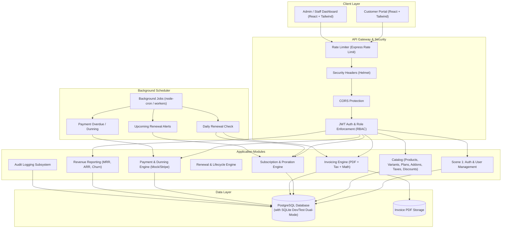
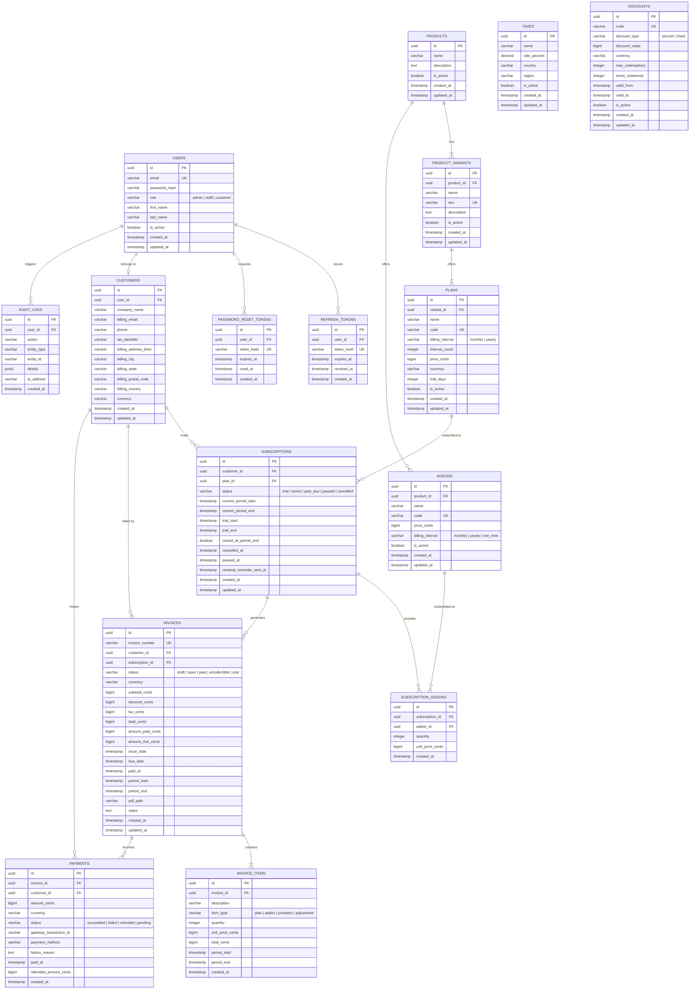

# Brightloop Billing — Architecture & ER Diagram

## 1. System Architecture Overview

Brightloop Billing is a unified subscription-billing platform built for modern B2B SaaS operations. It manages the complete lifecycle of customer subscriptions: product catalogs with variants, recurring billing, automated renewals, invoice generation with proration, payments & reconciliation, revenue reporting, and role-based access.

---

## 2. Role-Based Access Control (RBAC) Matrix

| Resource / Endpoint | Admin | Internal Staff | Customer |
| :--- | :---: | :---: | :---: |
| **Catalog: Create/Edit Products & Variants** | Full | Read-Only | Read-Only |
| **Catalog: Create/Edit Plans & Addons** | Full | Read-Only | Read-Only |
| **Catalog: Taxes & Discounts Management** | Full | Read-Only | Apply Only |
| **Staff Accounts Management** | Full (Create/List) | None | None |
| **Customer Accounts** | Full | View & Edit | View/Edit Own |
| **Subscriptions** | Full | View & Manage | View & Self-Service Own |
| **Invoices** | Full | View, Create, Issue | View & Download Own |
| **Payments & Refunds** | Full (incl. Refunds) | Record / View | Pay Own Invoices |
| **Revenue Analytics (MRR, ARR, Churn)** | Full | Read-Only | None |
| **Audit Logs** | Full | None | None |

---

## 3. Financial & Precision Policy
- **Minor Units (Integers)**: All monetary figures (`price_cents`, `subtotal_cents`, `tax_cents`, `discount_cents`, `total_cents`, `amount_paid_cents`, `amount_due_cents`) are strictly stored as **64-bit integers (`BIGINT`)** representing cents (or minor currency units).
- **No Floating-Point Arithmetic**: Decimal arithmetic and proration calculate day-fraction ratios using integer rounding (`Math.round()` / fixed integer arithmetic) to prevent floating-point drift or cent-rounding errors.
- **Proration Formula**: Mid-cycle changes calculate the remaining days of the current period:
  $$\text{Unused Credit} = \text{round}\left(\text{Plan Price} \times \frac{\text{Days Remaining}}{\text{Total Days in Period}}\right)$$
  $$\text{New Charge} = \text{round}\left(\text{New Plan Price} \times \frac{\text{Days Remaining}}{\text{Total Days in Period}}\right)$$
  $$\text{Net Proration Adjustment} = \text{New Charge} - \text{Unused Credit}$$

---

## 4. Entity-Relationship Diagram (ERD)

